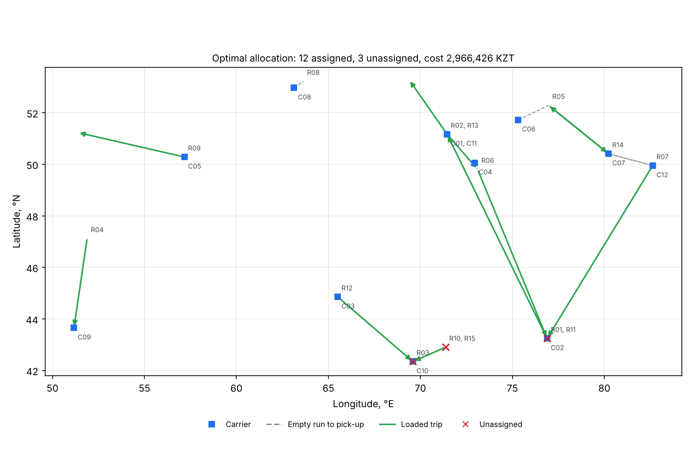

# cargo-dispatch

[](https://github.com/nursich/cargo-dispatch/actions/workflows/ci.yml)
[](https://github.com/nursich/cargo-dispatch/actions/workflows/release.yml)
[](pyproject.toml)
[](LICENSE)

**An intelligent system for distributing cargo transportation requests between carriers.**

Given a list of carriers (where each truck is, what body type it has, how much it can carry,
its tariff, rating and on-time history) and a list of cargo requests (origin, destination,
weight, cargo type, priority), `cargo-dispatch` decides **which carrier should take which
request** so that the overall result is as good as possible:

- only feasible pairs are considered (capacity, vehicle/cargo compatibility);
- each pair gets a **multi-criteria score** combining cost, reliability and rating;
- urgent requests weigh more, so they win scarce carriers;
- the best combination is found **exactly** with the Hungarian algorithm
  (linear assignment problem), with a fast greedy baseline for comparison.

The project was developed as the practical part of *Assignment 3 — Software Development
and Integration* (Astana IT University).



## Contents

- [Installation](#installation)
- [Quick start](#quick-start)
- [Input format](#input-format)
- [How it works](#how-it-works)
- [Results](#results)
- [Project structure](#project-structure)
- [Development](#development)
- [CI/CD](#cicd)
- [License](#license)

## Installation

Requires Python 3.10 or newer.

```bash
git clone https://github.com/nursich/cargo-dispatch.git
cd cargo-dispatch
python -m venv .venv
source .venv/bin/activate        # Windows: .venv\Scripts\activate
pip install -e ".[dev]"          # package + test/lint tools
```

## Quick start

Compare both strategies on the bundled sample (12 carriers, 15 requests across Kazakhstan):

```bash
cargo-dispatch compare --carriers data/carriers.csv --requests data/requests.csv
```

```
strategy             greedy     optimal
assigned                 12          12
unassigned                3           3
objective           13.3419     13.6143
mean_score              0.8      0.8227
total_cost_kzt   3522657.27  2966425.97
total_km            10134.3      8267.7
empty_km_share         0.34       0.167
```

Run one strategy, save the assignments and draw a map:

```bash
cargo-dispatch allocate --carriers data/carriers.csv --requests data/requests.csv \
    --strategy optimal --out results/assignments.csv --plot results/allocation.png
```

Change the importance of the criteria (weights are normalised automatically):

```bash
cargo-dispatch allocate ... --w-cost 0.7 --w-reliability 0.2 --w-rating 0.1
```

Use it as a library:

```python
from cargo_dispatch import OptimalAllocator, ScoringWeights, load_carriers, load_requests

carriers = load_carriers("data/carriers.csv")
requests = load_requests("data/requests.csv")
result = OptimalAllocator(ScoringWeights(cost=0.6, reliability=0.3, rating=0.1)).allocate(
    requests, carriers
)
print(result.summary())
print(result.to_dataframe())
```

## Input format

`carriers.csv`

| column | meaning |
|---|---|
| `id`, `name`, `city` | identifier, name, optional city label |
| `lat`, `lon` | current position of the truck (decimal degrees) |
| `vehicle_type` | `tent`, `refrigerator`, `tanker` or `flatbed` |
| `capacity_kg` | maximum payload |
| `rate_per_km` | tariff, KZT per km |
| `rating` | customer rating, 0–5 |
| `on_time_rate` | share of on-time deliveries, 0–1 |

`requests.csv`

| column | meaning |
|---|---|
| `id` | identifier |
| `origin_lat`, `origin_lon`, `dest_lat`, `dest_lon` | pick-up and drop-off points (`origin_city`, `dest_city` optional) |
| `weight_kg` | cargo weight |
| `cargo_type` | `general`, `perishable`, `liquid` or `oversized` |
| `priority` | 1 = normal, 2 = high, 3 = urgent |

## How it works

1. **Distances.** Great-circle (haversine) distance multiplied by a road detour factor of
   1.25, computed as vectorised NumPy matrices.
2. **Feasibility.** A carrier can take a request only if `weight_kg <= capacity_kg` and the
   vehicle type is allowed for the cargo type (perishable → refrigerator, liquid → tanker,
   oversized → flatbed, general → tent/refrigerator/flatbed).
3. **Score** of a feasible pair *(i, j)*, in [0, 1]:

   `score = w_cost · (1 − cost_ij / max_cost) + w_rel · on_time_j + w_rat · rating_j / 5`

   where `cost_ij = (empty_km + loaded_km) · rate_per_km_j`.
4. **Objective.** Maximise `Σ priority_weight_i · score_ij` over chosen pairs
   (priority weights 1.0 / 1.5 / 2.0), each carrier and each request used at most once.
5. **Solvers.**
   - `greedy` — most urgent request first, take the best free carrier; O(n·m).
   - `optimal` — Hungarian algorithm via `scipy.optimize.linear_sum_assignment`,
     O(n³); infeasible pairs get a large negative benefit and are dropped afterwards.

More detail: [docs/methodology.md](docs/methodology.md).

## Results

`python scripts/benchmark.py --instances 50` (fixed seed, random instances inside
Kazakhstan, equal numbers of requests and carriers):

| size | strategy | mean objective | mean assigned | empty-run share | time, ms |
|---:|---|---:|---:|---:|---:|
| 10 | greedy | 6.10 | 6.80 | 0.451 | 0.6 |
| 10 | optimal | **6.37** | **7.06** | **0.427** | 0.5 |
| 50 | greedy | 42.95 | 42.36 | 0.374 | 1.9 |
| 50 | optimal | **45.51** | **45.20** | **0.345** | 1.7 |
| 100 | greedy | 91.23 | 89.06 | 0.353 | 4.4 |
| 100 | optimal | **96.10** | **93.80** | **0.299** | 4.2 |

The exact solver is never worse than the greedy baseline (this is also checked by a
property-based test on 30 random instances) and serves about 5 % more requests with fewer
empty kilometres. At these sizes the run time is dominated by building the score matrices,
so the exact method costs practically nothing extra.

## Project structure

```
cargo-dispatch/
├── src/cargo_dispatch/
│   ├── models.py      # Carrier, CargoRequest, Assignment (+ validation)
│   ├── geo.py         # haversine and vectorised distance matrices
│   ├── scoring.py     # feasibility rules and multi-criteria score
│   ├── allocator.py   # GreedyAllocator, OptimalAllocator, AllocationResult
│   ├── io.py          # CSV loading/saving
│   ├── viz.py         # allocation map (matplotlib)
│   └── cli.py         # `cargo-dispatch` command
├── tests/             # pytest suite (89 tests, ~99 % coverage)
├── data/              # sample carriers and requests
├── scripts/           # benchmark and helper scripts
├── docs/              # methodology and figures
└── .github/           # CI/CD workflows, issue and PR templates, Dependabot
```

## Development

```bash
pytest --cov          # tests + coverage (fails below 90 %)
ruff check .          # lint
ruff format .         # format
mypy                  # static type check
```

Contribution rules are in [CONTRIBUTING.md](CONTRIBUTING.md). Bugs and ideas go to
[Issues](https://github.com/nursich/cargo-dispatch/issues).

## CI/CD

| workflow | trigger | what it does |
|---|---|---|
| [`ci.yml`](.github/workflows/ci.yml) | push to `main`, pull request | Ruff + mypy → tests on Ubuntu and Windows with Python 3.10–3.13 and coverage gate → demo run and benchmark (results uploaded as artifacts) → package build and wheel smoke test |
| [`release.yml`](.github/workflows/release.yml) | tag `v*.*.*` | tests, checks that the tag matches the version, builds the wheel/sdist and publishes a GitHub Release |
| [`dependabot.yml`](.github/dependabot.yml) | monthly | opens PRs to update Actions and pip dependencies |

To release a new version: bump `__version__` in `src/cargo_dispatch/__init__.py`, update
`CHANGELOG.md`, then `git tag v0.2.0 && git push --tags`.

## Citing

If you use this software, please cite it using [CITATION.cff](CITATION.cff).

## License

[MIT](LICENSE) © 2026 Nursultan Nurlybayev
